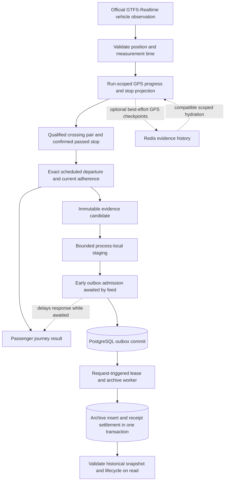

# Phase 1.6E — Architecture review and managed failure validation

## Decision

**Keep production archival disabled.** PostgreSQL preserved the evidence that crossed the outbox commit boundary. The current worker still has an unprotected interval before that commit, and archive admission adds latency directly to the response used by live bus monitoring. Managed tests reproduced both the latency penalty and a pre-commit loss. They establish recovery after a confirmed outbox commit under the tested faults. They leave production refresh performance, durable accounting before commit and managed compute restart recovery open.

This phase audited the Phase 1.6A–1.6D implementation and ran local and isolated managed validation with synthetic records. It changed no application code, migrations, GPS requirements, GTFS matching, ±120-second threshold, rail logic, or passenger classifications. The production gate returned no archive even with a valid test database URL when `VERCEL_ENV=production`. The test supplied that marker explicitly and did not inspect or modify Vercel.

## 1. Architecture and durability boundary

The PostgreSQL outbox commit is the first guaranteed durable handoff for a classification snapshot in this implementation. A later successful receipt lookup can confirm that the commit already happened. Optional Redis GPS evidence can help regenerate a compatible assessment. It is a separate best-effort write, so it supplies no per-candidate guarantee before PostgreSQL commit.

## 2. End-to-end durability and failure points

| Stage | Loss, rejection, delay, duplication or reconstruction | Guarantee and observable result |
| --- | --- | --- |
| Official observation and decode | Polling can miss a crossing entirely. Feed downtime, a decode failure, missing or out-of-range coordinates, the `(0,0)` sentinel, and missing or invalid vehicle timestamps prevent use. A feed publication time can exist while the vehicle measurement time is absent. | Feed health reports request failures. The 30-second realtime cache is per process. The decoder keeps measurement, publication and receipt context separate. The cache is neither a source journal nor an archive. |
| Progress and observation history | An older measurement is ignored in favour of the newest known record. Equal timestamps, run changes, a stale or future fix, a gap, a missing vehicle, source interruption and process exit can remove or replace usable history. The buffer retains at most eight fixes in a two-minute measurement window. Ambiguous route projections and implausible movement can yield low-confidence progress. | In-process continuity only. Optional Redis can rehydrate scoped, schema-validated checkpoints while retained, subject to matching, write success and expiry. GPS requirements still apply to hydrated evidence. |
| Passed-stop proof | A stop can lack a qualifying pair even if a vehicle has passed it. Projection ambiguity, insufficient movement, a gap over 60 seconds, a reverse or implausibly fast segment, and lack of later confirmation can prevent proof. A stronger same-stop pair may replace an older one. | The crossing uses original measured times and projected distances, then requires confirmation as passed. Progress and historical proof can age out independently. Animation contributes no observation. |
| Current adherence | Missing exact schedule, non-exact frequency data, stale/low-confidence tracking, run mismatch and missing pair produce an unknown classification. The client can show a retained last-valid result when conditions allow. | The classification remains a GPS-inferred comparison against an exact scheduled departure with ±120 seconds tolerance. It is independent of archival success and does not assert that a bus physically stopped. |
| Snapshot capture and journey cache | Only a directly evaluated, still-valid result on the accepted current journey is captured. A carried-forward display result, cached unchanged signature, invalid proof or expired candidate can omit an archive attempt. Repeated fixes and a reconfirmation of the same crossing reuse an ID. A different accepted crossing can create a new historical version for the same run-stop. | The snapshot contains the original pair, schedule, passage, generation and evaluated-fix times, version and checksum. It remains process-local at this stage. A rejected candidate's journey can be cached, so the next identical feed may return it without generating that candidate again. |
| Bounded admission | Capacity and oversized records are rejected. The process can die before enqueue, during an uncommitted transaction, or while retaining unresolved candidates. Pending age can grow while the database is unreachable, the caller is throttled or no new request wakes the instance. Expired pending candidates leave staging, with unknown outcomes counted separately. | Limits are 2,000 candidates, 4,000,000 serialized bytes and 256,000 bytes per batch. Counts and warnings explain rejections while the process is alive. A hard kill can erase candidates and their local accounting. Pending, rejected and unconfirmed candidates must be excluded from archive success counts. |
| PostgreSQL outbox admission | A real commit can be followed by a lost HTTP response. An absent receipt can race a late commit. A cancelled statement or pre-dispatch validation can prevent commit. Repeated submissions from multiple workers can overlap. | A positive receipt or acknowledged insert/conflict confirms admission under the current schema. Other uncertain outcomes remain staged and retry with the same ID. The primary key and conflict handling preserve the first payload. A `COMMITTED` admission can still be `PENDING`, `RETRYING` or `FAILED` at delivery. [PostgreSQL INSERT](https://www.postgresql.org/docs/current/sql-insert.html) |
| Archive worker and settlement | A request-triggered worker may never be woken on an idle instance. Locked rows can be skipped. A worker can die after claiming, the lease can expire, and recovery may be delayed by backoff. Expiry, exhausted attempts or a deterministic rejection settle as `FAILED`. Lost delivery acknowledgement can leave local counters below committed totals. | The token fences lease owners. Insert and settlement share a transaction. An attempt can be retried, while the terminal receipt and immutable archive remain unique by stable ID. Failed work is explicit in SQL. Current logs and local counters provide no centralized backlog or failure alert. |
| Historical read and retention | A missing row, unavailable connection, malformed evidence, unsupported proof version, newer valid version or expiry changes what a reader can retrieve. Physical cleanup, operator deletion, or provider loss can remove records. | Read verifies the stored proof, checksum and identity. A newer accepted version can mark an earlier record superseded. The default seven-day policy is measured from the service-day boundary. Logical expiry and physical cleanup are separate. Provider failover, backups and long-run cleanup are outside these tests. |

### Confirmation and accounting risks

- A passenger label can be current or retained without an archival receipt. The transit response exposes GPS evidence persistence diagnostics when configured. The PostgreSQL worker's `status()`, warnings and database receipts are separate, and the UI makes no archival success claim.
- An acknowledged admission with `alreadyQueued` relies on the existing table and insert contract. The query returns newly inserted IDs. An omitted ID is inferred to be a primary-key conflict. Any future database change that can silently suppress an insert, such as a `BEFORE INSERT` trigger returning null, would require receipt verification or an explicit acknowledgement contract. The current migrations install no such insert trigger. [PostgreSQL INSERT](https://www.postgresql.org/docs/current/sql-insert.html) · [PostgreSQL trigger functions](https://www.postgresql.org/docs/current/plpgsql-trigger.html)
- `lastAdmissionOutcome` describes an attempt. Counters are per instance, can reset and are not a historical ledger. Reconciliation can confirm individual IDs while peers stay unknown. Delivery metrics can miss a committed result if the worker misses its acknowledgement. Audit coverage using durable receipts joined to verified archive records.
- **The no-silent-loss criterion remains unmet across hard process termination.** Overload while a worker is alive was reported correctly. Before commit, the architecture has no independent per-candidate ledger or reliably replayable source to recover or count every missing snapshot after a crash.

## 3. Journey processing and refresh cadence

The runner compared the same synthetic source and history through `ProcessedBusJourneys.processWithPersistence`, once without an archive and once with the actual configured Neon HTTPS adapter. Redis was off and fixture loading was outside the timer. These measurements cover journey processing and the archive wait. They exclude live feed downloads, static parsing, request serialization, browser transfer and Vercel cold starts. Both sides returned exactly equal journeys in all trials.

| Scenario | Trials × vehicles | Candidates per trial | Archive off P50 / P95 | Archive on P50 / P95 | Added P50 / P95 | Confirmed by response |
| --- | ---: | ---: | ---: | ---: | ---: | --- |
| First managed batch series | 12 × 24 | 72 | 2.16 / 4.17 ms | 2,508.76 / 2,524.33 ms | 2,506.73 / 2,520.16 ms | 0 of 864 |
| Initial larger batch | 1 × 72 | 216 | 6.12 ms | 2,520.66 ms | 2,514.54 ms | 0 of 216 |
| Later single-vehicle series | 8 × 1 | 3 | 0.25 / 0.99 ms | 267.16 / 792.63 ms | 266.93 / 792.35 ms | 24 of 24 |
| Later 24-vehicle recheck | 1 × 24 | 72 | 2.34 ms | 842.17 ms | 839.83 ms | 72 of 72 |
| Immediate transport failure, later run | 1 × 24 | 72 | 2.27 ms | 9.63 ms | 7.36 ms | 0 of 72 |
| Injected 60-second transport delay | 1 × 24 | 72 | 1.76 ms | 2,510.14 ms | 2,508.38 ms | 0 of 72 |

For multiple trials the table uses nearest-rank percentiles. The first series had 12 enqueue deadlines and eight receipt deadlines. Four receipt reads completed in 756–870 ms without confirming the batch. The initial failure rows count client-confirmed admissions at return time. They cannot establish how many had committed later, since the runner reset those synthetic trials before the independent fault cases. The later series confirmed all 96 acknowledged intents using SQL before reset. It demonstrates variability on the same managed project. It does not resolve whether transport, provider routing, compute or local network conditions caused the difference.

The configured query budget is 1.5 seconds and the admission invocation uses a shared 2.5-second budget. A 60-second injected delay respected the abort signal. The enqueue and its receipt lookup both timed out, leaving 72 candidates staged with journeys intact. The measured ~2.51-second stall is a client-observed path, not a hard bound on synchronous work or an adapter that ignores cancellation. The archive budget is independent of the original HTTP request signal and remaining client time. Managed receipt reconciliation and same-ID retry timings are in section 6.

A Chromium test ran the dashboard from the local production build, using a controlled live fetch response and a simulated clock. It observed the actual component's request and abort behavior.

| Controlled first response | Observed next request |
| --- | --- |
| Released at 29 s | Next request started on the 30-second poll. |
| Held until 31 s | The 30-second poll queued one refresh. It started at 31 s as the prior request completed. |
| Held past the client deadline | The request aborted at 55 s and the queued refresh started at 55 s. |

These tests cover the client timer and coalescing logic. The managed journey tests above measure the PostgreSQL wait separately.

The dashboard polls every 30 seconds. The server realtime cache also uses 30 seconds, measured from the most recent fetch. Those clocks are separate. The live route waits on all sources, and each bus source waits for journey processing including archive admission. The routes declare a 60-second maximum duration. The dashboard aborts at 55 seconds, and the standalone detail fetch aborts at 25 seconds. The normal archive path can add hundreds of milliseconds. A timeout and receipt lookup can spend around 2.5 seconds. Applied to a slow otherwise successful request, that delay can cross a polling boundary or consume the remaining client time. For example, 53 seconds of other dashboard work plus the measured 2.51-second wait crosses 55 seconds. A 23-second detail path plus the same wait crosses 25 seconds. These are deadline calculations from measured admission latency, not observed production outages. The full upstream request latency distribution and refresh SLO remain unmeasured.

## 4. Why 416 candidates were rejected

The sustained case offered 600 synthetic candidates at a time, four times over 60 seconds, with application access to PostgreSQL blocked. There was no successful drain during the injection. The staged 1,984 records used 3,999,036 bytes, leaving only 964 bytes under the byte cap. The records were roughly 2 KB each. The remaining 416 were rejected before reaching PostgreSQL, even though the count ceiling was 2,000. This was the combination of the offered burst, the length of the outage, zero admitted database throughput during the injection, and the buffer configuration. It is not evidence that PostgreSQL cannot sustain that arrival rate when reachable. Phase 1.6D observed the same capacity boundary using the same fixture inputs and a different outage schedule. [Phase 1.6D validation](timetable-adherence-evidence-phase1-6d.md)

The managed readback found **1,984 of 2,400 candidates archived (82.67%)**, all with `PERSISTED` receipts, and **416 of 2,400 absent (17.33%)**. The 416 absent IDs matched the recorded capacity rejection count. Replaying the exact original fixture inputs at the original evaluation time reproduced all 416 IDs. Removing the original GPS fixes produced zero admissible candidates. The replay did not insert the rejected records. In operation, the same cache signature can skip a fresh capture, and there is no persisted per-candidate retry record for a rejected ID. Redis may retain enough evidence for some runs, but was off here, can expire or fail, and does not preserve the exact classification snapshot. Production recoverability of the rejected candidates is unverified.

Live classification coverage and archive coverage have different denominators. A capacity rejection occurs after classification, so it does not withdraw a correct current label. It does reduce the chance of retaining that result for historical use. The controlled denominator here is 2,400 valid synthetic candidate IDs, not eligible passed stops in the production fleet. Internal telemetry recorded one capacity warning with the exact 416 count. It did not report those candidates as durably admitted. The UI and the GPS evidence status omit the archival rejection count, and logs cannot trace each rejected ID across a process replacement.

## 5. Pre-commit durability options

| Option | Guarantee and failure behaviour | Complexity, memory and operational cost |
| --- | --- | --- |
| Direct admission to current outbox | Earliest simple durable point while PostgreSQL is reachable. Does not survive a crash before commit or a complete outage before submission. Waiting for confirmation spends live response time. | Lowest infrastructure cost. Uses the existing database and bounded process memory. Requires idempotent receipt reconciliation and a response budget or a different scheduling boundary. |
| Separate durable upstream staging | Extends durability to the upstream journal acknowledgement. Covers a PostgreSQL outage if the upstream journal is independently available. Same-database staging does not cover database unavailability. Unacknowledged upstream writes still have an uncertain interval. | Highest implementation and operational cost. Requires a second failure domain or an existing verified durable input, retention, replay, backpressure and monitoring. The live path can still be delayed if it waits for upstream confirmation. |
| Bounded staging and backpressure | Limits resource usage during interruptions, and can preserve the live response by returning with an explicit archival failure. Uncommitted candidates and process-local counters can vanish on a hard kill. | Low complexity and bounded serialized staging per instance. More capacity delays rejection at the cost of heap pressure. Track aged pending work, uncertain attempts and per-source rejection counts. |
| Replay retained GPS and timetable context | A valid replay needs original measured fixes, run/projection/schedule context, confirmation and the original evaluation time. Redis retention and read/write failures, missing observations and schema/context changes can prevent replay. | Moderate or high engineering cost to validate and audit deterministic replay. May reuse an existing verified source. Retaining only selected GPS checkpoints cannot by itself guarantee reconstruction of the original snapshot. |

Keep the single PostgreSQL outbox for the confirmed-write guarantee. Before enabling it, demonstrate admission within the live response budget in the target deployment region or decouple archival wait from the live response with explicit, observable acceptance. With either scheduling choice, agree on whether the product requires every candidate to survive a pre-commit crash. If it does, require a proven durable upstream acknowledgement or a reproducible input journal before activation. The current optional Redis evidence path has no per-candidate replay guarantee. These findings do not justify introducing an external queue during the audit.

## 6. Managed failure validation

Tests ran from a Windows client in Malaysia against a dedicated Neon Claimable PostgreSQL 17.11 project in `aws-us-east-2`. The project held synthetic data only. The configured application uses the pooled HTTPS adapter. Controls used direct TLS-verified sessions to the same managed database, including an 8-second per-query control during the initial fault and recovery run. The direct adapter did not cancel an in-flight SQL query at the 2.5-second application budget, so these controls are not measurements of the configured HTTPS deadline. The temporary project was provisioned specifically for this phase and expires on 13 November 2026 at 00:33 MYT. [Neon Claimable](https://neon.com/claimable-neon) · [Neon serverless driver](https://neon.com/docs/serverless/serverless-driver)

| Scenario | Result |
| --- | --- |
| Kill before commit | A child inserted the intent inside an open managed PostgreSQL transaction and was killed before commit. Neither outbox nor archive had a row. A fresh process recovered zero candidates for that ID. |
| Kill immediately after commit | The child committed and was killed before the application received the acknowledgement. The pending intent survived. A fresh process using the configured HTTPS worker archived it in **1.79 s** and exact readback matched. An earlier run's fresh-worker attempt did not acknowledge an insert under the runtime deadlines. |
| Lost commit acknowledgement with receipt available | A real managed commit response was discarded in the harness. The managed receipt lookup took **263.09 ms** over the direct control connection. The complete lost-response and reconciliation attempt took **539.95 ms** and resolved as `COMMITTED`. |
| Lost acknowledgement with receipt read blocked | The outcome stayed unknown. The same-ID retry on the direct connection took **261.72 ms** after advancing the harness clock past the two-second throttle. It found the existing intent. The retry did not replace the original. |
| Connection interruption and reconnect | The test terminated its own managed PostgreSQL backend with an open transaction. Commit failed and the uncommitted row stayed absent. A new verified TLS connection reached a different backend in **2.07 s**, including the verification query. |
| Concurrent workers and retries | Four managed sessions competed for a shared ID and for claims. They archived three distinct records, each with one attempt and one terminal receipt. Twelve additional same-ID submissions did not change any snapshot, attempt count or receipt. |
| Capacity and sustained outage | A **60.01 s** injected application transport block prevented dispatch. Independent PostgreSQL remained reachable. Four admissions stayed unconfirmed, and the capacity warning counted all 416 rejections. This exercises the application during an outage and leaves a provider-wide outage untested. |
| Recovery with pending candidates | Direct controls confirmed **1,984 pending** intents in **10.77 s** after access returned, including two waits between admission invocations. Peak observed staging residence was **62.73 s**. Two invocations lasted 2.79 s and 2.75 s as a native query completed after the worker loop budget. The initial drain and readback command ended with a query error, so its elapsed drain time is unavailable. A later readback in batches of 64 verified all 1,984 settled receipts and matched every archived payload to the original. The verification took **14.77 s** and required no additional archive writes. |
| Managed compute continuity | The first managed connection reported a PostgreSQL process start at **00:33:10 MYT** on 10 November. The later verification reported a new start at **10:41:55 MYT** and retrieved the settled records. This establishes persistence across an observed change of PostgreSQL process. **Controlled managed restart recovery with pending or leased intents remains unverified.** The test did not induce a full restart or provider failover. Phase 1.6D separately exercised a controlled local PostgreSQL restart. |

## 7. Production readiness and regression

Keep production archival disabled until an isolated test colocated with the intended deployment measures end-to-end refresh and detail latency with healthy, slow and unavailable PostgreSQL. Count client deadline misses, skipped poll slots, unresolved admissions, pending age and verified archive completions separately. A later test should also exercise the actual managed compute restart boundary. Treat operator cleanup, alerting and a worker wake-up strategy as part of that readiness decision. No change to the classifier is needed to address these operational gaps.

| Regression check | Result |
| --- | --- |
| Full Vitest suite, including Phase 1.6A–1.6D coverage | 349 passed across 28 files, including 18 archive and outbox tests. |
| TypeScript | Passed with `tsc --noEmit --incremental false`. |
| ESLint | Passed. |
| Next.js production build | Passed on Next.js 15.5.28. |
| Playwright Chromium | 100 passed against the local production build. |

[Managed timing and fault results](<C:/Users/loong/.codex/visualizations/2026/10/31/01a19042-26fc-77d0-9d6f-54c350d6b494/adherence-evidence-phase1-6e/validation-results.json>) · [Initial runtime deadline trials](<C:/Users/loong/.codex/visualizations/2026/10/31/01a19042-26fc-77d0-9d6f-54c350d6b494/adherence-evidence-phase1-6e/first-attempt.json>) · [Bounded managed readback](<C:/Users/loong/.codex/visualizations/2026/10/31/01a19042-26fc-77d0-9d6f-54c350d6b494/adherence-evidence-phase1-6e/backlog-readback.json>) · [Chromium cadence results](<C:/Users/loong/.codex/visualizations/2026/10/31/01a19042-26fc-77d0-9d6f-54c350d6b494/adherence-evidence-phase1-6e/cadence-results.json>)
