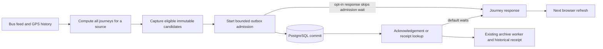

# Phase 1.6F — Decoupled admission and pre-commit durability

## Decision

The local prototype moves the PostgreSQL wait off the journey response while starting admission at the same point in feed processing. It retains the in-flight promise through the existing request lifecycle. PostgreSQL commit remains the first durable boundary. Keep production archival disabled until the target runtime validates refresh latency, post-response execution and the required recovery guarantee before commit.

## 1. Phase 1.6E baseline and current critical path

Phase 1.6E measured an added **839.83 ms** in a successful 24-vehicle managed trial and **2,506.73 ms P50** in twelve 24-vehicle trials that returned without confirmed admissions. The dashboard polls every 30 seconds and aborts a fetch at 55 seconds. The managed outage workload archived 1,984 of 2,400 synthetic candidates and rejected 416 at the staging byte limit. Killing a process before commit lost its candidate. These are managed baseline observations. The Phase 1.6F experiments use local PostgreSQL with controlled delays. [Phase 1.6E audit](timetable-adherence-evidence-phase1-6e.md)

The source processor calculates journeys, matches stops and captures qualifying evidence before waiting on PostgreSQL. A slow database therefore does not block the calculation of another vehicle in that same batch, or synchronously block the event loop. It delays **publication of every vehicle in the affected feed**. The dashboard route waits for all sources, so it also delays otherwise ready sources. Requests sharing the same source-processing promise can inherit the wait. Archive admission is single-flight within each archive instance. Another feed can wait on the same writer. If Redis GPS persistence is configured, the archive admission and Redis write can overlap, while Redis hydration and persistence keep their existing behaviour.

The browser's 55-second timer aborts its own `fetch`. Neither route forwards that signal into feed retrieval, journey processing or the PostgreSQL adapter. Server-side feed fetches use their own timeout. PostgreSQL uses a 1.5-second query deadline and a separate 2.5-second admission budget, including receipt checks. The routes declare a 60-second maximum duration. A disconnected client can stop waiting while its work continues, subject to the actual host runtime. Next's lifetime extension for registered work is bounded by the route duration and depends on host support. [Next.js after and route duration](https://nextjs.org/docs/15/app/api-reference/functions/after)

## 2. Architecture alternatives

| Option | Journey latency and queue behaviour | Pre-commit durability, cost and recovery |
| --- | --- | --- |
| Current awaited admission | Capture and database admission are on the response path. It uses bounded staging, retries unresolved writes, and delays otherwise valid results during network stalls. | The waiter can confirm durable admission before returning when the database is reachable. Outage, process termination and expiry before commit still threaten the snapshot. Reuses the current database and worker. |
| Bounded asynchronous admission, started immediately | Starts at the current admission point, shares the same writer and retains work through the request lifecycle. The journey response skips the database wait. The same caps and retry backpressure apply. | Preserves commit and receipt semantics. The response can return while evidence is still volatile. Minimal integration work and no extra datastore. A process restart recovers only committed intents. |
| Post-response-only asynchronous admission | Removes the response wait but defers even the first write until the response finishes. A slow sibling source or response can increase staging residence and pressure. | Extends the volatile interval before a first attempt. The existing after-response drain is still useful for follow-up and archive delivery. |
| Direct writes during candidate generation | A synchronous write per stop or vehicle adds round trips and blocks generation. An asynchronous per-stop variant needs bounded concurrency and is harder to batch consistently. | PostgreSQL can atomically admit a validated batch. In-process candidate generation cannot be recovered by that transaction after a pre-commit crash. Starting one bounded write at feed completion retains useful batching. |
| Durable upstream staging | A separate durable acknowledgement can sit on the live path unless its input is captured independently. It requires a real queue, retention, overload control and operator recovery. | Protects candidates after upstream acknowledgement through a PostgreSQL outage when the upstream store is in a separate failure domain. More operational cost. A journal on the same database shares the outage boundary. |
| Reconstruct from retained GPS observations | Leaves normal journey latency alone and shifts work to replay. Bounded GPS history limits storage at the cost of recoverability. | Requires the original qualifying fixes, run identity, projection, schedule and evaluation context. Optional existing GPS evidence is best effort. Phase 1.6E recovered rejected IDs from exact synthetic inputs only. A reproducible input journal would need separate validation. |

## 3. Local opt-in prototype

Set `TRANSIT_CLASSIFICATION_DEFER_ADMISSION=1` only in an isolated environment with the existing archive configuration. The default remains awaited and the production gate still disables the archive. An opted-in feed starts the existing admission operation immediately after capture and hands its promise to the route's `after` registration. The installed Next 15.5.28 runtime registers a promise with `waitUntil`. The separate existing `after(() => flush())` callback can still retry eligible pending work and perform delivery. It shares the same archive instance and admission flight. Missing or failing lifetime registration falls back to awaited admission. [Next.js after](https://nextjs.org/docs/15/app/api-reference/functions/after)

The prototype reuses the original immutable snapshot, deterministic record ID, conflict handling, receipt verification, delivery lease and transactional archive settlement. It keeps the 2,000-record, 4,000,000-byte and 256,000-byte batch limits, and the existing retry and expiry rules. It uses the same ±120-second threshold and returns the same passenger classification data.

| Internal outcome | Meaning |
| --- | --- |
| Pending | Evidence is in the current process's retry buffer, possibly with an unknown commit outcome. The prototype logs that candidates are still pending before durable admission. |
| Committed | An insert acknowledgement, existing intent or positive receipt confirms durable admission. This is distinct from a historical archive write. |
| Rejected | Invalid, oversized or capacity-limited evidence was refused, with the existing reason-specific warning. |
| Unrecoverable from this buffer | The candidate expired without a confirmed handoff or an earlier ambiguous outcome in this process. Expired candidates whose commit is still unknown have a separate counter. |
| Process loss before commit | A crash can erase pending evidence and its counters. The process cannot emit a terminal status after it dies. The pending log makes exposure visible but cannot reconcile each lost ID. |

Status and diagnostic counts are internal and per instance. Committed counts report confirmations and can include a rediscovered ID after the bounded deduplication cache evicts it. The archive row and receipt remain the source for exact historical coverage.

## 4. Comparative benchmark and latency breakdown

The paired runner used the same synthetic GPS and timetable fixtures as Phase 1.6E. It seeded history before timing, ran the real journey processor, compared every result to the archive-disabled result for that fixture, and serialized the real gzip transit response. Two independent clients used the same disposable loopback PostgreSQL 18.6 cluster. The response-ready timing includes the fixture equality check. It excludes official feed downloads, Redis, hosted cold starts and browser transfer.

The controlled healthy delays were 260 ms for one vehicle and 840 ms for the 24-vehicle comparison, plus actual local SQL. The slow control injected a 60-second wait before each database operation, respecting the same 1.5-second query and 2.5-second admission signals used by the application. The immediate failure control rejected transport before dispatch. The lost-acknowledgement control suppressed a real local commit response and added a 263 ms receipt delay. Local SQL had a separate 1.5-second query guard. The artificial delay is a comparison control drawn from Phase 1.6E. It does not measure managed database latency.

| Scenario | Paired trials | Journey response ready, awaited P50 / P95 | Journey response ready, deferred P50 / P95 | Admission including verification, awaited / deferred P50 | Durable intents per mode |
| --- | ---: | ---: | ---: | ---: | ---: |
| Healthy, 1 vehicle | 8 | 275.29 / 280.72 ms | 1.09 / 6.31 ms | 274.45 / 273.72 ms | 24 |
| Healthy, 24 vehicles | 1 | 869.53 ms | 12.97 ms | 860.51 / 851.75 ms | 72 |
| Slow, 24 vehicles | 12 | 2,514.49 / 2,524.37 ms | 10.44 / 21.19 ms | 2,506.49 / 2,505.42 ms | 0, all 864 pending |
| Slow, 72 vehicles | 1 | 2,527.80 ms | 24.54 ms | 2,507.61 / 2,505.33 ms | 0, all 216 pending |
| Immediate failure, 24 vehicles | 1 | 17.67 ms | 10.69 ms | 10.97 / 3.49 ms | 0, all 72 pending |
| Lost acknowledgement, 24 vehicles | 1 | 552.40 ms | 9.35 ms | 545.06 / 540.86 ms | 72 confirmed by receipt |

The table uses nearest-rank percentiles. Single trials show their observed value. Counts cover the whole series for that mode. The healthy and lost-response cases confirmed all expected intents. Timeout and immediate-failure cases retained all candidates in their own process. Journey output matched the archive-disabled case in all 48 timed runs. The response improvements come from removing the wait. The database operation still takes roughly the same time, and a deferred response alone says nothing about durable admission.

### Contribution of each stage

| 24-vehicle scenario and mode | Journey computation excluding capture | Candidate capture | Enqueue transport and acknowledgement | Receipt verification | Processor returned | Gzip serialization |
| --- | ---: | ---: | ---: | ---: | ---: | ---: |
| Healthy, awaited | 2.60 ms | 3.66 ms | 858.02 ms | — | 866.77 ms | 1.97 ms |
| Healthy, deferred | 2.71 ms | 3.30 ms | 848.96 ms | — | 8.92 ms | 3.03 ms |
| Slow, awaited P50 | 1.92 ms | 2.70 ms | 1,507.71 ms | 992.96 ms | 2,511.17 ms | 2.37 ms |
| Slow, deferred P50 | 2.07 ms | 2.71 ms | 1,504.85 ms | 994.82 ms | 7.48 ms | 2.40 ms |
| Lost acknowledgement, awaited | 1.98 ms | 2.46 ms | 266.50 ms | 276.53 ms | 549.51 ms | 2.21 ms |
| Lost acknowledgement, deferred | 1.84 ms | 2.34 ms | 265.37 ms | 273.23 ms | 6.41 ms | 2.21 ms |

Elapsed stage metrics include harness and event-loop scheduling where applicable. Processor and serialization times are sequential. In deferred mode the network and receipt stages overlap the response path and must be counted separately. The archive-disabled 24-vehicle processor took 4.09–8.95 ms P50 across the two lanes of the slow series, reflecting local scheduling variation.

## 5. Failure injection

| Scenario | Observation |
| --- | --- |
| Termination before commit | The deferred worker inserted one intent inside an open local PostgreSQL transaction. The process was killed before commit. An independent session saw no intent or archive row, and a fresh worker could recover zero for that ID. |
| Termination immediately after commit | The worker committed one intent, then was killed before its admission call received the response. The intent remained pending. After a real local PostgreSQL stop and restart, a fresh process archived the exact original snapshot. |
| Outage before admission and sustained pressure | PostgreSQL was stopped and refused connections for **60.01 s**. Four bursts of 600 candidates reproduced the Phase 1.6E workload. The opted-in worker retained **1,984** records at **3,999,036 bytes** and explicitly rejected **416** at the byte cap. There were no confirmed intents during the outage. |
| Recovery after outage | With the same application process alive, admission of all 1,984 staged candidates took **179.44 ms** after PostgreSQL became reachable. Four local workers drained them in **165.63 ms**. Every stored snapshot matched its original fixture. The oldest observed staging residence was **61.17 s**. |
| Lost commit acknowledgement | A real local commit was followed by an injected lost response and unavailable receipt lookup. The first outcome stayed unknown. A retry with the same ID after advancing the throttle clock took **0.58 ms** and found the existing row. A separate positive receipt test reconciled in **2.42 ms**. The timed 24-vehicle receipt tests reported the separately injected transport delay. |
| Concurrent admission and replay | Two calls on the same deferred archive shared one write in the focused test. Four independent local PostgreSQL sessions resubmitted a settled ID. The original record and terminal receipt stayed identical, with one delivery attempt. |
| Slow PostgreSQL and known cancellation | The matched slow trials returned equivalent journeys with all 864 candidates per mode still pending after their admission budgets. A separate server-cancelled statement produced `NOT_COMMITTED`, with no outbox row. |
| Sustained durable backlog | Four continuous local workers drained 5,000 records in **368.06 ms** and 10,000 in **594.56 ms**. SQL verified one historical row and one terminal receipt per input. These are loopback controls, separate from per-request worker budgets. |
| Browser request abort during slow processing | Chromium's fetch aborted at **76.30 ms** in a local HTTP fixture. The server observed the disconnect at **77.42 ms**. Another simulated source kept the response path busy until **189.17 ms**. The installed Next `AfterContext` registered the already-started admission promise in the fixture's request-lifetime collector. All three intents confirmed after the disconnect in **855.34 ms** from admission start. This tests local lifecycle and transport behaviour. Hosted cancellation and timeout enforcement remain unverified. |

During the sustained outage, local Node RSS rose from **174.54 to 197.26 MiB** and used heap from **67.59 to 105.77 MiB** at sampled peaks. These figures include the harness and synthetic input generation. The staged byte count bounds serialized records, while the process also retains objects, caches and driver state. Deferral does not expand the queue or protect the 416 rejected candidates. The two termination tests establish exactly where the durable guarantee starts.

The production-build Chromium cadence check also observed the actual dashboard timer. When a controlled response arrived at 29 s, the next request started at 30 s. When it arrived at 31 s, the queued refresh started at 31 s. Holding it beyond the deadline triggered the abort and queued retry at 55 s. Removing the measured archive wait can preserve a poll slot when the other work is near 30 seconds, or preserve client deadline margin when it is near 55 seconds. The tests measured admission and the dashboard timer separately. Production request latency remains unmeasured.

## 6. Remaining risks and readiness

**The no-silent-loss criterion remains unmet across a hard pre-commit crash.** The prototype reports live pending, rejection, expiry and uncertain outcomes and preserves committed snapshots. A pending log does not durably capture evidence or guarantee per-ID accountability. This limitation also applies when a hosted instance is terminated or does not get enough post-response time. During an outage, an instance can fill its bounded buffer or fail to receive a future retry trigger. An independent durable input or upstream acknowledgement is necessary if every candidate must survive this window.

Keep production archival disabled. The prototype is suitable for isolated latency evaluation. Before reconsidering activation, measure the actual deployment path in the target region with the flag both off and on. Include time spent on other feeds, client aborts, early response versus confirmation, host time limits, retry wake-ups, pending age and durable receipts. Decide whether the product can tolerate explicit pre-commit rejections and loss on hard termination. A stronger guarantee requires reproducible original inputs or a durable handoff before declaring acceptance. Neither the local timings nor the managed Phase 1.6E results establish hosted request-lifetime or compute restart recovery for this prototype.

| Local regression check | Result |
| --- | --- |
| Full Vitest suite | 353 passed across 28 files, including 22 archive and outbox tests. |
| TypeScript | Passed with `tsc --noEmit --incremental false`. |
| ESLint | Passed. |
| Next.js production build | Passed on Next.js 15.5.28 after clearing a stale OneDrive entry in generated `.next` output. |
| Playwright Chromium | 100 passed against the local production build, plus the cadence and real disconnect controls above. |

[Local test results](<C:/Users/loong/.codex/visualizations/2026/10/31/01a19042-26fc-77d0-9d6f-54c350d6b494/adherence-evidence-phase1-6f/validation-results.json>) · [PostgreSQL and browser fault harness](<C:/Users/loong/.codex/visualizations/2026/10/31/01a19042-26fc-77d0-9d6f-54c350d6b494/adherence-evidence-phase1-6f/validate-local.cjs>) · [Chromium cadence results](<C:/Users/loong/.codex/visualizations/2026/10/31/01a19042-26fc-77d0-9d6f-54c350d6b494/adherence-evidence-phase1-6f/cadence-results.json>)
